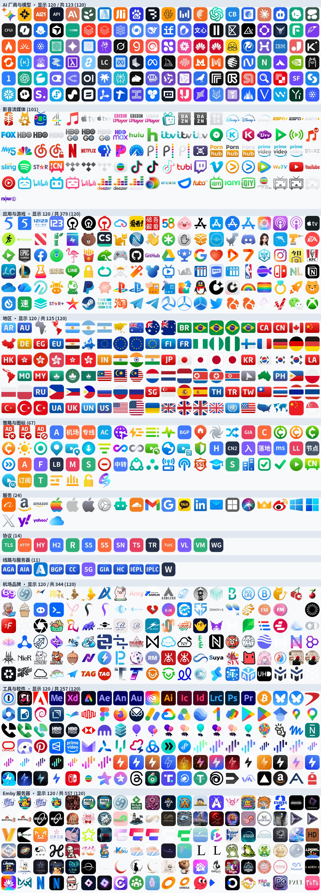

# 图标集

40250 个图标，按用途分成 **12 个分类图标集**，App Store 部分再按品类细分成 26 个子集。

```
全部：  https://raw.githubusercontent.com/Zerolost/VqssLs/main/icon/icons.json
分类：  https://raw.githubusercontent.com/Zerolost/VqssLs/main/icon/sets/ai.json
```



App Store 部分抽样：[preview-appstore.jpg](preview-appstore.jpg)（共 38248 个，随机 400 个）

## 分类

| 分类 | 数量 | 内容 |
|---|---:|---|
| `appstore` | 38248 | App Store 抓取的 App 图标（按品类分子目录） |
| `emby` | 557 | Emby 服务器图标 |
| `app` | 379 | 应用与游戏 |
| `brand` | 344 | 机场与代理品牌 |
| `tool` | 257 | 代理软件与工具 |
| `region` | 125 | 国家与地区 |
| `ai` | 123 | AI 厂商、模型、客户端 |
| `media` | 101 | 影音流媒体 |
| `policy` | 67 | 策略、机场、线路标识 |
| `service` | 24 | 平台服务 |
| `protocol` | 14 | 代理协议 |
| `server` | 11 | 线路类型与网络 |

## 图标集（sets/）

`icon/sets/` 下每个分类一个 JSON，App Store 另有按品类的子集（≥30 个才单独出）：

| 文件 | 说明 |
|---|---|
| `sets/ai.json` | AI 厂商与模型 |
| `sets/app.json` | 应用与游戏 |
| `sets/appstore.json` | 全部 App Store 图标 |
| `sets/appstore-games.json` 等 | 按品类拆分（games / social / productivity / utilities / photo…） |
| `sets/brand.json` | 机场品牌 |
| `sets/emby.json` | Emby 服务器 |
| `sets/media.json` | 影音流媒体 |
| `sets/policy.json` | 策略与图标 |
| `sets/protocol.json` | 代理协议 |
| `sets/region.json` | 国家与地区 |
| `sets/server.json` | 线路与服务器 |
| `sets/service.json` | 平台服务 |
| `sets/tool.json` | 工具与软件 |

在 Surge 里可以直接把一个集合当图标源用：

```ini
[Proxy Group]
🇭🇰 香港 = select, policy-path=..., icon-url=https://raw.githubusercontent.com/Zerolost/VqssLs/main/icon/icons/region/HK.png
🤖 ChatGPT = select, ..., icon-url=https://raw.githubusercontent.com/Zerolost/VqssLs/main/icon/icons/ai/OpenAI.png
🎮 游戏加速 = select, ..., icon-url=https://raw.githubusercontent.com/Zerolost/VqssLs/main/icon/icons/appstore/Games/王者荣耀_989673964.png
```

图标名就是文件名去掉 `.png`，可在 `icons.json` 或对应的 `sets/*.json` 里查。

## 目录

```
icons/
  ai/ media/ app/ region/ policy/ service/ protocol/ server/ brand/ tool/ emby/
  appstore/<品类>/       App Store 图标，按品类分目录
sets/                    按分类拆好的图标集 JSON
icons.json               全量索引
categories.json          图标名 → 分类目录
appstore-index.json      App Store 图标的名称 / 开发者 / 地区 / 品类
preview.jpg              分类预览（每类最多 120 个）
preview-appstore.jpg     App Store 抽样预览
build_icons.py           重建索引与 sets/
make_brand_icons.py      品牌 SVG → 圆角图标
make_typingmind_icons.py TypingMind 模型图标
make_text_icons.py       文字占位图标
```

## 来源

| 来源 | 内容 |
|---|---|
| [Qure](https://github.com/Koolson/Qure) | 主体彩色图标集（MIT） |
| [lige_icon](https://github.com/lige47/lige_icon) | 机场品牌、代理软件、国内软件、国家、Emby |
| [TypingMind](https://custom.typingmind.com) | AI 模型与厂商 |
| [simple-icons](https://simpleicons.org) / [Iconify](https://iconify.design) | 品牌矢量图标 |
| [App Store](https://apps.apple.com) | 通过 iTunes Search API 抓取的 App 图标 |
| 自绘 | 协议名、策略组名、线路类型 |

## 新增图标

1. 把 PNG 放进 `icons/<分类>/`（App Store 的放 `icons/appstore/<品类>/`）。
2. 图标名写进 `categories.json`，不写会落到 `other/`。
3. 推送后 GitHub Actions 自动重建 `icons.json` 与 `sets/`。

## 抓取脚本

```sh
# 导入 lige_icon 的图标
GITHUB_TOKEN=xxx python3 tools/import_lige.py

# 爬 App Store（多国家 × 关键词，默认上限 3000）
python3 tools/crawl_appstore.py --max 3000
python3 tools/crawl_appstore.py --countries cn,us --terms 视频,音乐

# 重建索引与 sets
python3 icon/build_icons.py --rebuild
```

App Store 抓取参考了 [mszhangopopop/IconLibrary](https://github.com/mszhangopopop/IconLibrary) 的做法：
用 `itunes.apple.com/search` 按关键词搜索，图标取 `artworkUrl512` 同目录下的 `256x256bb.png`。
